# Copilot Earn-In Academy: Simulation User Guide

> **Public documentation copy.** No sign-in is required to read this guide or its screenshots here. References to approved sessions apply to the simulation and its app-hosted documentation. This repository does not host the application; obtain its URL from your facilitator.

**Edition:** Simulation MVP · **Updated:** October 16, 2026

**Audience:** Learners, facilitators, reviewers, program administrators, and testers.

> **Fictional data only.** This is a browser-local simulation, not a production learning-management system. Role switching previews interfaces; it does not sign you in or protect records from other people using the same browser. Never enter actual employee details, confidential prompts, customer information, or restricted work content.

This guide explains the current application, not proposed production features. Screenshots were captured from the running app with fictional records. Most show the **Developing learner** scenario after the actions described; reporting screenshots use freshly loaded **Normal cohort** and **Small cohort** scenarios. Dialog screenshots show the visible portion of a scrollable form.

## 1. Start here

### Open the simulation

1. Give your GitHub username to your facilitator for approval, then open the application URL they supply.
2. Select **Sign in with GitHub** and use the approved account. A GitHub account alone does not grant entry.
3. Confirm that the top banner says **Simulation — fictional data only**.
4. Wait for **Saved in this browser** before making changes.
5. Begin with **Developing learner**, or load **New learner** for a blank learning record.

The online guide, Markdown downloads, and screenshots require the same approved session. **Access denied** or **503** means you should contact the facilitator, not try another URL. **Sign out of GitHub tester session** ends app access but does not erase local simulation records or sign you out of GitHub's website. Use separate browser profiles for separate testers. Offline copies deliberately shared by the facilitator remain readable without sign-in.

If you are using the project workspace, open VS Code's **Ports** panel, forward port **3000**, leave visibility **Private**, and select **Open in Browser**. The local address is `http://localhost:3000`. The workspace must remain running. If the server has stopped, ask the operator to follow section 19.

### A five-minute orientation

1. Inspect **My dashboard** and its recommended habits.
2. Open **My 30-day path** and select a lesson.
3. Open **Evidence journal** to see the fictional examples.
4. Change **Preview role** to **Champion** to inspect submitted workflows.
5. Change **Preview role** to **Sponsor** to inspect the cohort report.
6. Return to **Learner** to continue.

Switching roles does not delete records. Loading or resetting a scenario does.

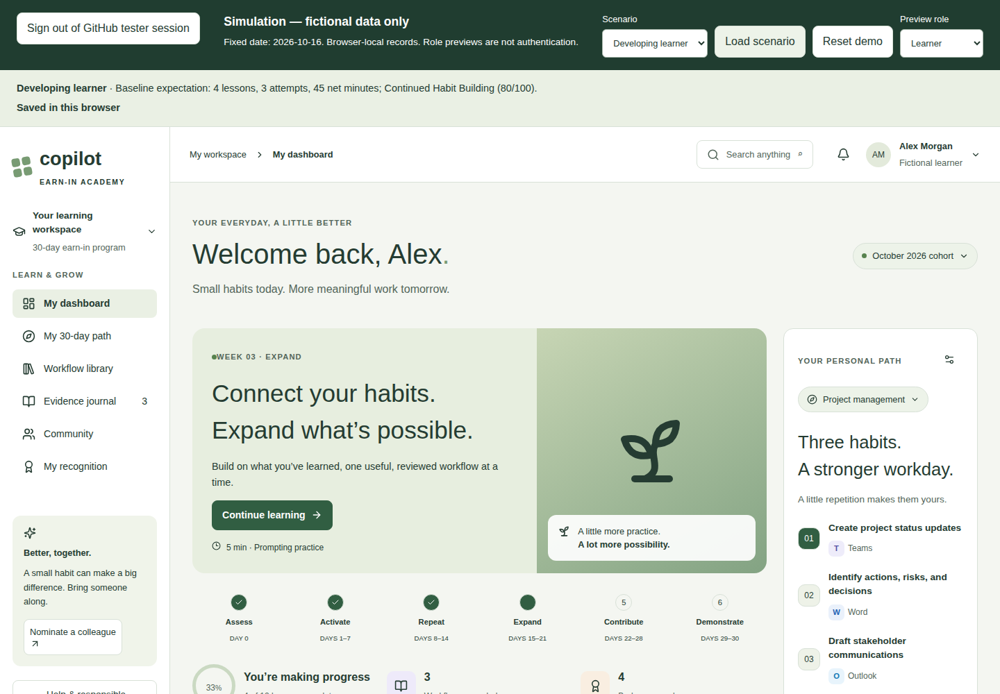

*Figure 1. The dashboard introduces the learning journey. The simulation toolbar above it is available in every role.*

## 2. Understand the simulation controls

| Control or message | What it does | Important detail |
| --- | --- | --- |
| **Scenario** | Selects the scenario you intend to load. | Selecting an item alone does not replace your records. |
| **Load scenario** | Replaces this browser's simulation with the selected scenario after confirmation. | Deletes local simulation edits, reviews, questions, and nominations. Returns to Learner. |
| **Reset demo** | Restores the currently loaded scenario after confirmation. | Uses the active scenario, not an uncommitted dropdown selection. |
| **Preview role** | Switches between Learner, Champion, Administrator, and Sponsor. | A demonstration control, not authentication or authorization. |
| **Baseline expectation** | Describes the initial scenario's expected result. | It is a reference label, not a live summary; it does not change when you edit records. |
| **Saved in this browser** | Confirms the current simulation was written to local storage. | Does not mean uploaded, synchronized, or backed up. |
| **Not saved** or an error banner | Signals that persistence needs attention. | Read the warning before closing or refreshing the page. |

### The fixed simulation clock

- The simulated date is **October 16, 2026**, regardless of today's actual date.
- Learners start on **October 1, 2026**; the learning path therefore shows **Day 16** at baseline.
- The reporting cohort spans **October 1–30, 2026**.
- Dated reporting observations stop at **October 16**, not October 30.
- New evidence dates are limited to **October 1–16**.
- Calendar-session examples also use October 2026. They are not live bookings.

This fixed clock makes tests repeatable. **New learner** means no completed lessons or evidence; it does not move the cohort back to Day 1. A week-three banner is therefore expected even for that scenario.

## 3. Choose a scenario

| Scenario | Initial learner record | What to verify |
| --- | --- | --- |
| **New learner** | Assessment incomplete; no lessons or evidence; readiness 0/100. | Assessment, first lesson, first journal entry, and first recognition. |
| **Developing learner** | Four completed lessons; three repeated attempts; 45 net estimated minutes. | Continued Habit Building at 80/100, progress, repeated practice, and three work surfaces. |
| **Strong contributor** | Twelve lessons, a private value story, peer help, and a separate pending redacted submission. | Champion Candidate at 100/100; graduation recognition and reviewer feedback. |
| **Blocked learner** | High-readiness learner with technical and governance blockers. | Blocker Remediation takes precedence even at 100/100. |
| **Slower attempt** | One attempt: 10 minutes before and 15 minutes with Copilot. | Journal shows **-5 min**, not zero or a positive saving. |
| **Small cohort** | Four fictional learners. | Sponsor report values and CSV export are suppressed. |
| **Normal cohort** | Twenty fictional learners. | Calculated baseline reporting values in section 13. |
| **Consent declined** | Active learner has private evidence but no workflow submission or Workflow Creator badge. | Permission alone does not expose evidence or create contribution credit. |

Except for **Small cohort**, the scenarios include 20 fictional learners. Peers may already have redacted submissions. Seeing those submissions in a review queue does **not** mean Alex's private evidence has been shared.

### Load a clean test

1. Select the desired **Scenario**.
2. Select **Load scenario**.
3. Read the replacement warning.
4. Confirm to discard the existing simulation, or cancel to keep it.
5. Check the scenario name in the baseline summary and the save status.

Do not reset midway through a journey if you want to keep its changes.

## 4. Navigate the learner workspace

| Page | Use it to |
| --- | --- |
| **My dashboard** | Resume learning, inspect three recommended habits, edit your commitment, and view sample sessions. |
| **My 30-day path** | Browse twelve lessons, filter by week, personalize your path, and build a final value story. |
| **Workflow library** | Search, filter, save, copy, and download reusable example prompts. |
| **Evidence journal** | Record attempts, compare time observations, export your journal, and remove entries. |
| **Community** | Read fictional stories, ask a champion, record peer help, submit a redacted workflow, or nominate a colleague. |
| **My recognition** | Inspect badges, build a value story, and view your next-path assessment. |

The six journey phases are **Assess**, **Activate**, **Repeat**, **Expand**, **Contribute**, and **Demonstrate**. Date-based positioning is separate from completed-lesson progress.

The top search button finds lessons and role-relevant workflows. Notifications and sample champion contacts are learning aids, not external messaging integrations.

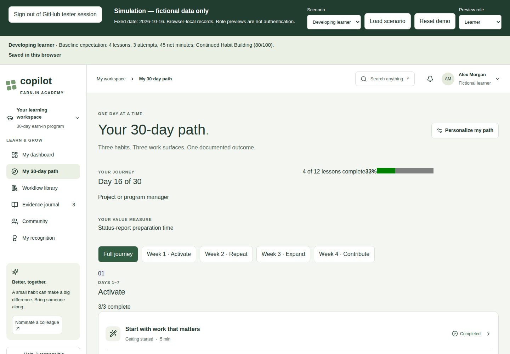

*Figure 2. Use the path to browse lessons; use week controls to find earlier or later content.*

## 5. Complete or update your assessment

1. In **New learner**, select **Find my path** on the dashboard. Otherwise select **Personalize my path** on the learning path, or the dashboard's **Edit persona and habits** control.
2. Choose **Your primary role**. Ten choices cover sales, management, projects, analysis/finance, HR, marketing, IT/operations, executive support, general work, and a custom starting point.
3. Optionally record a secondary persona.
4. Select time-consuming activities and applications used.
5. Record frequency, Copilot experience, and the outcome you want.
6. Choose a license/access option and record concerns.
7. Review sharing willingness, willingness to help, manager support, and time commitment.
8. Review the recommended habits, applications, capability, and measures.
9. Select **Make this my path**.

**Example outcome:** "Prepare a clearer fictional weekly status report with fewer missing action owners."

The outcome is required and must contain at least 10 characters. Changing the primary persona or supported task choices can change recommendations. Some other assessment fields are recorded as context; do not assume every selection changes the recommendation.

For a technical blocker, select **Access or technical blocker** under **Microsoft Copilot license**. For a repeatable governance-routing test, load **Blocked learner**. The current simulation recognizes the literal phrase `governance blocker` in the concerns field; it does not intelligently classify arbitrary concern text.

Selecting **Approved Copilot Chat only** or **I'm not sure** does not itself reduce the numeric readiness score. An explicitly recorded blocker changes the support route.

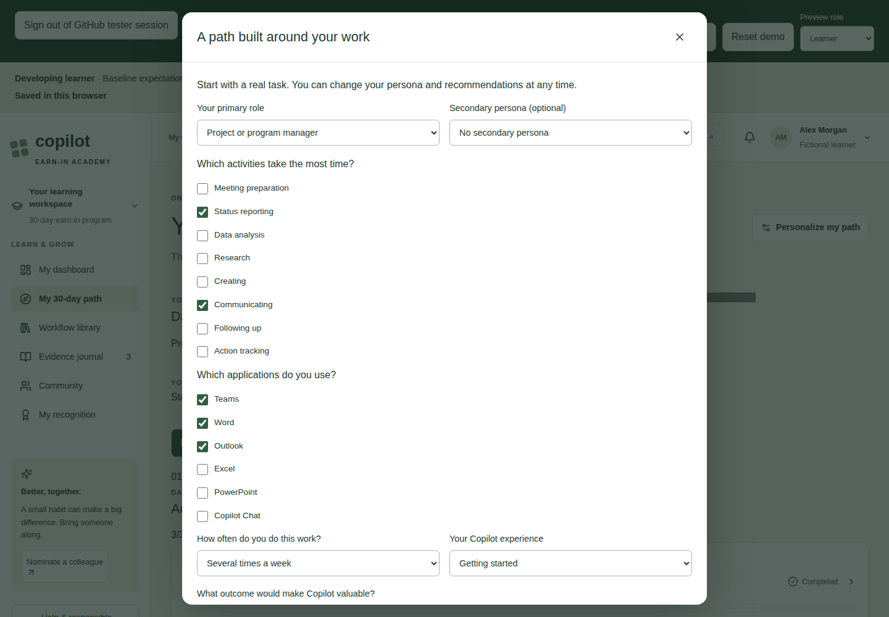

*Figure 3. The assessment continues below the visible area. Scroll inside the dialog to reach the outcome, access options, and save button.*

## 6. Take a lesson and save completion

1. Open **My 30-day path**.
2. Select the relevant week, or show all lessons.
3. Open a lesson row. **Continue learning** on the dashboard also opens the next incomplete lesson.
4. Read the overview, demonstration, guided practice, and example prompt.
5. Expand **Read transcript** if useful. Current lessons are text-first examples; supplied video recordings are not integrated.
6. Optionally select **Copy lesson prompt** or **Download workflow**. These actions do not complete the lesson or execute Copilot.
7. Answer **One quick check**.
8. Write a practice reflection of at least 15 characters describing the fictional task and your human-review step.
9. Confirm **I completed the guided practice and understand the review requirements**.
10. Select **Complete lesson**.

**Success:** The dialog closes and the lesson row shows **Completed**. Refreshing should preserve the completion.

An incorrect answer prompts another attempt. Missing reflection or confirmation prevents completion. Reopening an already completed lesson allows review; it does not award another completion.

Lesson completion and evidence are different records. **Record workplace evidence** opens the evidence form; it does not by itself complete the lesson.

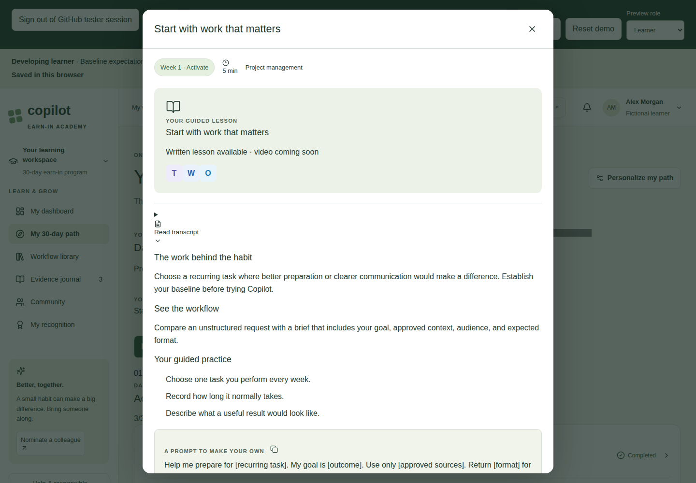

*Figure 4. Scroll further inside the lesson to reach the knowledge check, reflection, review confirmation, and completion action.*

## 7. Use the workflow library

1. Open **Workflow library**.
2. Search for a task, title, or prompt text.
3. Narrow results using **Persona**, **Business task**, **Application**, **Level**, **Agent**, **Time**, **Data sensitivity**, and **Status**.
4. Use **For my persona** to set the persona filter and clear the search text. Other active filters remain in place.
5. Open a workflow card to read its prompt and human-review steps.
6. Use **Save workflow** or a card's bookmark control to save it.
7. Use **Saved (count)** to toggle the saved-only view.
8. Select **Copy prompt**. If clipboard access is unavailable, the app downloads a text version instead.

**No results:** Clear the search and return each active filter to its general option. Turn off saved-only mode if necessary. There is no separate one-click "clear all filters" control.

**Verified** means an illustrative editorial status in the sample catalog. It is not approval for your organization's data or a guarantee that generated output is correct. Saved prompts remain browser-local. No Copilot session is opened or executed by saving or copying.

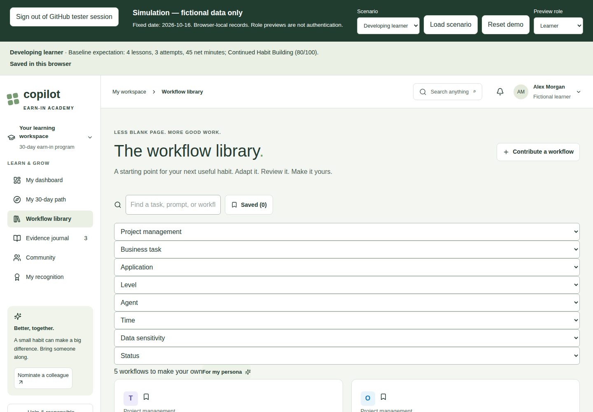

*Figure 5. Filters combine. A restrictive combination can legitimately produce no results.*

## 8. Record and manage evidence

### Save an attempt

1. Open **Evidence journal**.
2. Select **Record a workflow**.
3. Complete the fields below using fictional information.
4. Scroll to the review and sharing-permission checkboxes.
5. Select **Save private evidence**.
6. Check the entry and updated journal totals, then confirm **Saved in this browser**.

| Field | What to enter | Current validation or behavior |
| --- | --- | --- |
| **Date** | Date of the fictional attempt. | Required; October 1–16, 2026. |
| **Application** | Where the attempt happened, such as Word or Teams. | Select one application surface. |
| **Capability or agent (optional)** | Researcher, Analyst, Cowork, another approved agent, or None. | Does not count as an extra application surface. |
| **What recurring task did you work on?** | A consistent task name, such as "Weekly project status update". | Required; 3–150 characters. Repeated-evidence matching ignores case and outer spaces, not different wording. |
| **Your prompt or workflow** | Fictional prompt with placeholders. | Required; 10–5,000 characters. |
| **Time before (minutes)** | Baseline task duration. | Required; 0–10,000. |
| **Total time with Copilot (minutes)** | Duration including review and corrections. | Required; 0–10,000. |
| **Time observation** | Estimated or Measured. | Both are self-reported, not independently verified. |
| **What changed?** | Outcome, including limitations. | Required; 10–2,000 characters. |
| **What improved in quality?** | Optional quality observation. | Up to 1,000 characters. |
| **What still needs work?** | Lesson or next improvement. | Required; 5–1,000 characters. |
| **I reviewed the output...** | Whether important claims were checked against sources. | An unchecked attempt remains review-pending. |
| **I permit a sanitized version...** | Permission to consider a sanitized version. | Does not submit, publish, or expose the entry to reviewers. |

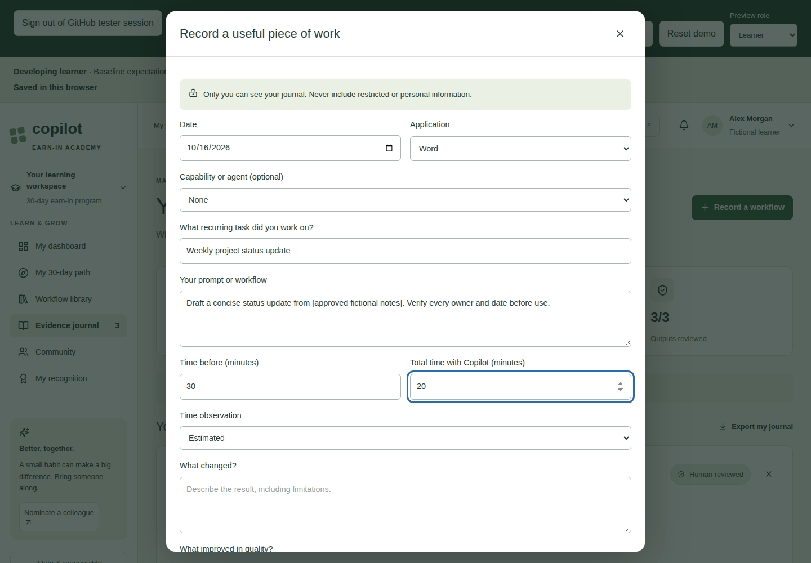

*Figure 6. This is the upper portion of the evidence form; scroll inside it for quality, lessons, review confirmation, sharing permission, and save.*

### Understand the journal metrics

- **Workflows recorded:** Number of entries, including unreviewed attempts.
- **Self-reported time difference:** Sum of baseline minutes minus new minutes.
- **Work surfaces explored:** Distinct application surfaces, not agent names.
- **Outputs reviewed:** Reviewed entries divided by all entries.

For an attempt that goes from **30 to 20 minutes**, the difference is **+10**. An attempt that goes from **10 to 15** contributes **-5**. Slower attempts are retained rather than hidden.

The screenshot below shows four entries and **55 min** because a new +10-minute example was added to the Developing learner baseline of three entries and 45 minutes.

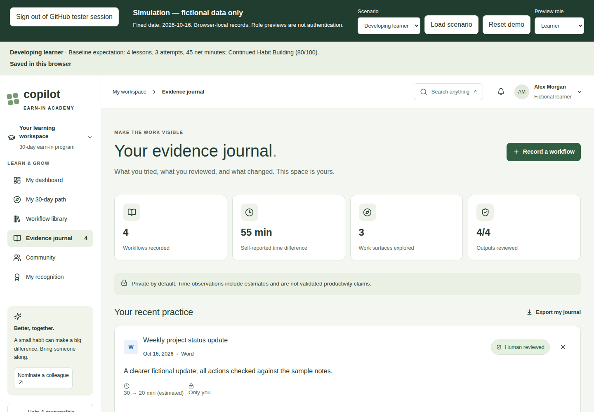

*Figure 7. Recorded evidence changes live totals; the scenario's baseline-expectation text above the app stays unchanged.*

### Inspect, export, or remove an entry

- Expand **Reflection & prompt** to inspect the prompt, quality observation, and lesson.
- Select **Export my journal** to download `my-private-evidence.json`. This is raw learner evidence; it is not an aggregate or redacted export. The simulation has no journal-import control.
- Use an entry's delete control, read the confirmation, and select **Remove entry** to delete it.
- Deletion can change totals, readiness, and recognition. It has no undo control.
- Existing entries cannot currently be edited in place. Remove an incorrect entry and create a replacement.

## 9. Build a private value story

1. Open **My recognition** or the final section of **My 30-day path**.
2. Select **Build my value story**.
3. Describe your fictional role, recurring problem, previous process, workflow, applications/capabilities, human review, result, limitations, and next habit.
4. Write at least 80 characters; the maximum is 10,000.
5. Select **Save & reflect on my next step**.

**Success:** The story is saved in the learner record and the next-path assessment opens. Reopen the story later to revise it.

Saving a story does not put it in the champion queue or publish it. To share a workflow, use the separate process in section 11.

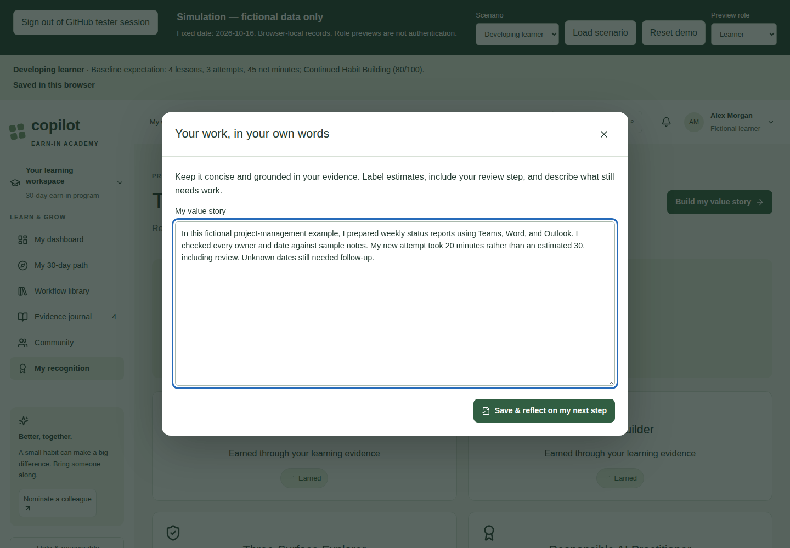

*Figure 8. The story is private within the learner interface; never use real data in the simulation's browser storage.*

## 10. Understand recognition and next-path recommendations

### Recognition in this MVP

| Badge | Current earning rule |
| --- | --- |
| **First Win** | At least one evidence entry. |
| **Responsible AI Practitioner** | Responsible-AI lesson completed and at least one reviewed attempt. |
| **Habit Builder** | Three entries with the same normalized recurring-task name. |
| **Three-Surface Explorer** | Evidence across three distinct supported applications. |
| **Agent Explorer** | Agent-explorer lesson completed and reviewed evidence naming a capability/agent. |
| **Workflow Creator** | A separate workflow submission has been made. Approval is not required for this contribution badge. |
| **Community Helper** | Learner confirms peer help in Community's Challenges tab. |
| **Value Storyteller** | A saved story of at least 80 characters. |
| **30-Day Graduate** | All twelve lessons completed and a saved story of at least 80 characters. |

Other catalog badges, including formal champion/department/program recognition, are not automatically earned by this simulation. A Champion Candidate recommendation is not a manually approved champion award.

After graduation, **Download simulation completion summary** produces a simulation-only text file. It is not an official certificate. The current graduation rule checks lessons and story length, not whether thirty actual calendar days have elapsed.

### Readiness criteria

Open **My next-path assessment** from My recognition.

| Criterion | Maximum points | Simulation interpretation |
| --- | --- | --- |
| Recurring use case | 15 | A nonempty desired outcome is recorded. |
| Learning participation | 15 | Proportional to completed lessons, up to twelve. |
| Repeat workflow evidence | 20 | Proportional to the largest same-task group, up to three entries. |
| Multiple work surfaces | 10 | Proportional to distinct supported applications, up to three. |
| Responsible review | 10 | At least one entry exists and every entry is marked reviewed. |
| Value observation | 15 | At least one entry has an outcome. |
| Peer contribution | 10 | Peer-help confirmation is checked. |
| Sponsor support | 5 | Manager/sponsor support is recorded. |

The total is rounded to a whole number. Removing evidence or adding unreviewed evidence may change the score. These are simulation rules, not independent verification of work or a measure of employee quality.

### Routing order

1. **Blocker Remediation:** Any recognized technical or governance blocker, regardless of score.
2. **Champion Candidate:** At least 80, peer-help confirmation, an actually submitted workflow, and responsible review.
3. **Advanced Copilot and Agents:** At least 70, the Agent Explorer condition, and responsible review.
4. **Continued Habit Building:** At least 50 if none of the earlier routes applies.
5. **Self-Service with Re-entry Option:** Otherwise.

Readiness supports learning and support routing. It must not be interpreted as employment evaluation or an automatic license decision.

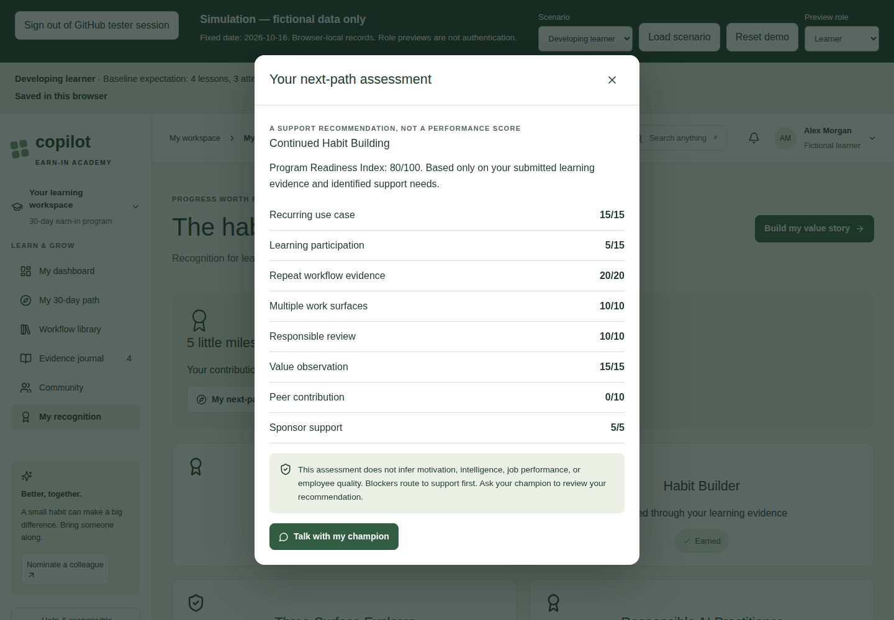

*Figure 9. This example remains a support recommendation, not a performance score.*

## 11. Use Community and deliberately share a workflow

### Stories, questions, and peer help

- **Stories:** Read four fictional examples. Their outcomes are not verified organizational claims.
- **Questions:** Enter a sanitized fictional question of 10–2,000 characters and select **Ask a question**. It appears as Open until a simulated champion answers.
- **Challenges:** Confirm peer help if your fictional test includes it. This affects Community Helper and the peer-contribution criterion.
- **Learn together:** Session cards can save a local RSVP and download a sample `.ics` calendar file. No meeting is booked and no invitation is sent.

### Submit a separate redacted workflow

1. Open **Community** and select **Share a workflow**, or use **Contribute a workflow** in the library.
2. Enter a **Workflow title** of 3–150 characters.
3. Write **Reusable workflow** text of 40–5,000 characters in the UI.
4. Use placeholders such as `[approved source]`, `[audience]`, and `[confirmed owner]`. Include the human-review step and limitations.
5. Confirm **This is sanitized, approved to share, and includes human review**.
6. Select **Submit for review**.

**Success:** A new pending submission exists, and the learner's **My submissions** summary appears above the workspace. The separately typed text enters the simulated assigned-reviewer queue. The application does not copy the private journal into that queue.

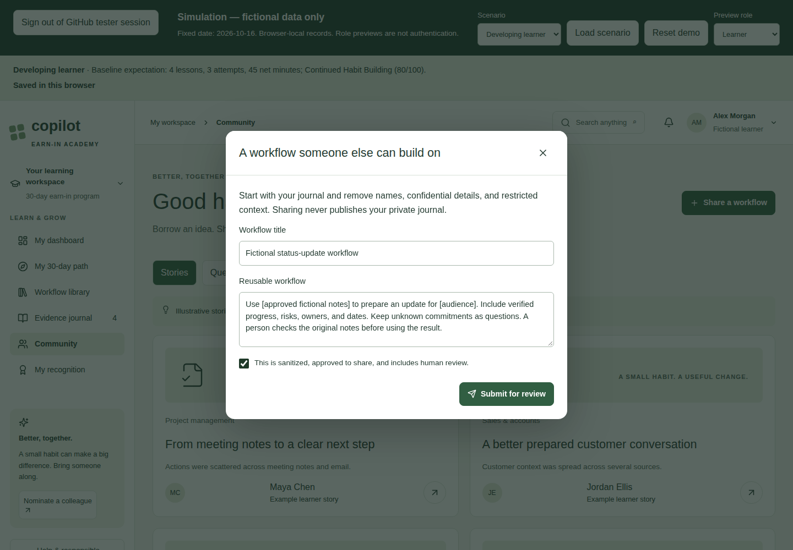

*Figure 10. Evidence-sharing permission, actual submission, review, and publication are separate actions.*

There is no automatic publication, submission withdrawal, or consent-revocation workflow in this MVP. To start over with entirely fictional data, reset the scenario; this discards all local simulation edits.

## 12. Review workflows and nominations

### Champion: review submitted workflows

1. Set **Preview role** to **Champion**.
2. Inspect **Assigned learning status**. It shows fictional learner names, lesson counts, and general support status, not journal contents.
3. Find the relevant item in **Workflow review queue**.
4. Read only the separately submitted redacted text.
5. Choose **Approve for simulation** or **Request changes**.
6. Write **Review feedback** of 5–1,000 characters.
7. Select **Save workflow review**.
8. Return to **Learner** and inspect **My submissions**.

| Displayed status | Meaning |
| --- | --- |
| `pending` | Submitted; no review decision has been saved. |
| `approved` | Approved for the simulation. Nothing is automatically published. |
| `changes-requested` | Reviewer requests revisions; feedback is visible to the learner. |

Reviewers can save another decision later. The simulation does not provide an immutable decision history. The learner cannot edit a submitted item in place; a revised example must be submitted separately.

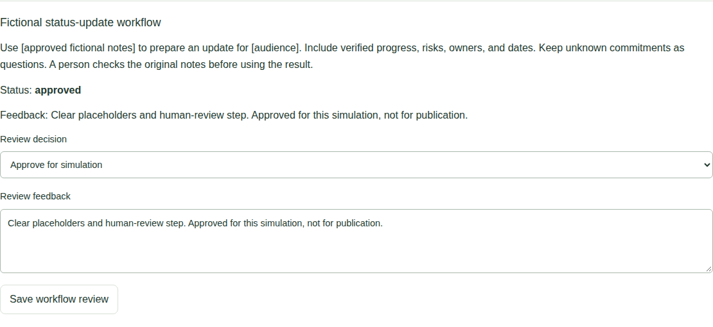

*Figure 11. This cropped screenshot focuses on one review card, not the private learner journal.*

### Champion: answer a question

1. Scroll to **Submitted questions**.
2. Enter a **Champion answer** of 10–2,000 characters.
3. Select **Save answer**.
4. Return to **Learner → Community → Questions** to read the reply.

Answers are saved locally. They do not send email, Teams messages, or notifications to another account.

### Learner: nominate a fictional colleague

1. In the sidebar choose **Nominate a colleague**, or use **Community → Challenges → Invite someone to the next cohort**.
2. Choose Peer, Manager, or Self-nomination.
3. Enter a fictional name and an address such as `learner@example.invalid`.
4. Describe the fictional recurring task in 15–2,000 characters.
5. Confirm permission to share the fictional contact details.
6. Select **Submit nomination**.

**Success:** The nomination is stored as `pending`. No message is sent and no real account or cohort membership is created.

### Administrator: decide a nomination

1. Set **Preview role** to **Administrator**.
2. Scroll past workflow reviews and submitted questions to **Nomination review**.
3. Read the fictional name, contact address, and reason.
4. Select **Approve nomination** or **Decline nomination**.
5. Return to Learner to see `approved` or `declined` in **My submissions**.

Approval only updates local status; it does not provision an identity or send an invitation. Administrators also have the simulated review functions and cohort report.

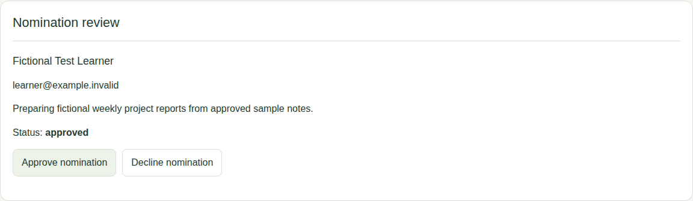

*Figure 12. Use fictional contact details even when testing nomination permission.*

## 13. Inspect and export cohort reports

1. Load **Normal cohort** to begin with reproducible baseline data.
2. Set **Preview role** to **Sponsor**. Administrators can also scroll to **Cohort report**.
3. Inspect the metrics and reporting-window description.
4. Select **Export aggregate report** to download `fictional-cohort-report.csv`.

### Normal cohort baseline

| Metric | Expected value | How to interpret it |
| --- | --- | --- |
| Learners | 20 | Active fictional learner plus simulated peers. |
| Participating | 16 | Current records with completed lessons or an eligible evidence attempt. |
| Completed with a story | 8 | Twelve lessons plus a story of at least 80 characters. |
| Attempts in window | 42 | Eligible evidence dated October 1–16. |
| Net estimated minutes | 570 | Sum of baseline minus new duration, including slower attempts. |
| Redacted submissions | 8 | Eligible consented submissions assigned to this cohort/champion, regardless of review decision. |
| Support blockers | 4 | Current records routed to Blocker Remediation. |

The displayed **Net estimated minutes** is a self-reported time-difference total; the current calculation does not separate Estimated and Measured entries into separate totals.

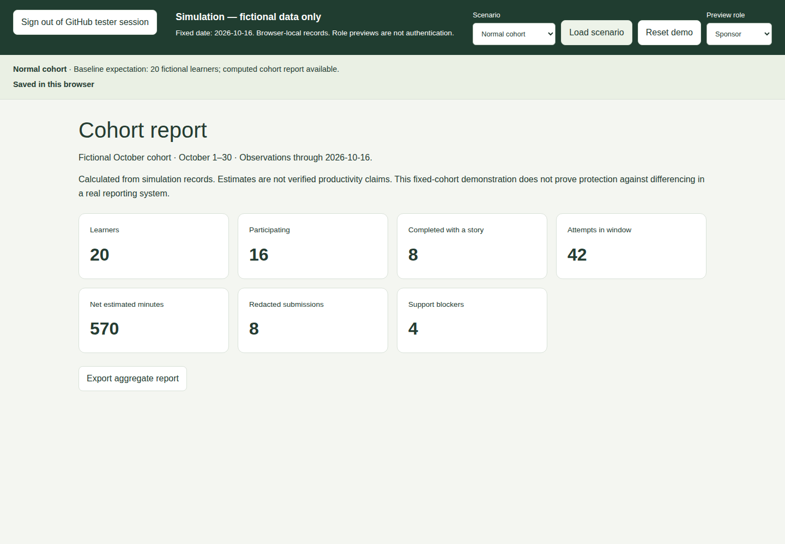

*Figure 13. Reports are calculated from records rather than fixed chart numbers.*

### Prove that reports change

1. Note the Normal cohort baseline: 42 attempts and 570 net minutes.
2. Switch to **Learner** without loading another scenario.
3. Add one October 16 evidence entry: baseline 20 minutes, new duration 10 minutes.
4. Switch back to **Sponsor**.
5. Expect **43 attempts** and **580 net estimated minutes**.
6. Refresh to verify persistence.
7. Reset the loaded scenario to restore the baseline.

### Small-cohort suppression

1. Load **Small cohort**.
2. Switch to **Sponsor**.
3. Expect a suppression notice.
4. Confirm that aggregate values and **Export aggregate report** are absent.

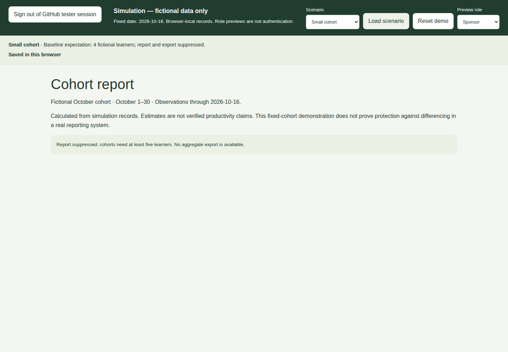

*Figure 14. Four learners are below the minimum cohort size of five.*

**Privacy limitation:** This is a fixed-cohort demonstration. It does not prove protection against repeated-export differencing, overlapping cohorts, or small subgroups inside larger cohorts. Participation, completion, and blocker counts reflect current state, not historical completion-event timestamps. Do not use it for actual employee reporting.

## 14. Use the application on a phone or with a keyboard

### Mobile navigation

1. Find the **Open navigation** menu button beside the breadcrumb below the simulation toolbar.
2. Select a learner page in the slide-out navigation.
3. The panel closes after selection.
4. Use **Close navigation** on the dimmed background if you want to dismiss it without navigating.

The simulation toolbar wraps onto multiple rows on small screens. Scenario and role controls are above the learner workspace, not inside its navigation panel.

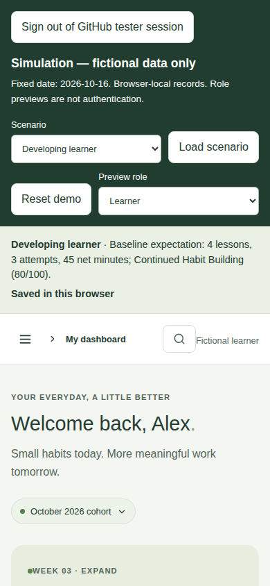

*Figure 15. The mobile dashboard shows the same records and controls as desktop within that browser.*

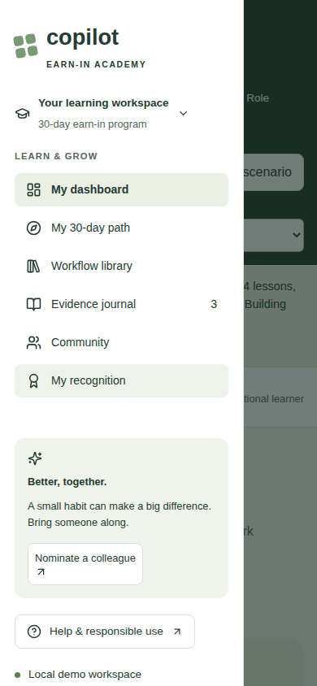

*Figure 16. Short screens can scroll the navigation panel.*

### Keyboard and reading tips

- Use Tab and Shift+Tab to move through controls; visible outlines identify focus.
- Use the **Skip to content** link when entering the learner workspace.
- In a dialog, Tab cycles through its controls; Escape or **Close dialog** dismisses it.
- Scroll inside long dialogs to reach lower fields and save actions.
- Open text transcripts instead of relying on video.
- Reduced-motion preferences are respected by styling.

Automated desktop/mobile checks are not a WCAG certification. Manual assistive-technology acceptance is still required before a real pilot.

## 15. Save, reset, and export safely

### What is remembered

The simulation saves assessment, lesson completions, evidence, stories, nominations, submitted questions/answers, peer-help confirmation, saved prompts, local RSVPs, fictional peers, and review decisions in this browser.

It does not synchronize to a server, another device, another browser profile, or another tester. Preview role, dialog drafts, search/filter settings, and the uncommitted scenario selection are not guaranteed to survive refresh. Refresh returns to Learner.

The local-storage key is `earn-in-simulation-v2`. Older `earn-in-academy-v1` data is not imported or deleted by the new simulation.

### Reset versus refresh

| Action | Effect |
| --- | --- |
| Refresh the page | Restores the saved simulation; unsaved dialog drafts can be lost. |
| Change Preview role | Shows another interface using the same simulation records. |
| Select a scenario only | Changes the pending selection; records stay as they are. |
| Load scenario and confirm | Replaces simulation records with that scenario's fixtures. |
| Reset demo and confirm | Replaces records with fixtures for the currently loaded scenario. |
| Clear browser site storage | Removes saved simulation data and possibly unrelated data for this origin. |
| Export journal | Downloads raw learner evidence only, not a full simulation backup. |
| Export report | Downloads aggregates only, not an importable learning record. |

The MVP has no full simulation backup/import or undo-after-reset control. Keep useful test observations outside the application before resetting.

Use a single active browser tab for a test run. There is no multi-tab conflict resolution; another tab may have stale records and overwrite changes when it saves.

## 16. Troubleshooting

| Problem | What to do |
| --- | --- |
| The app URL does not open | Verify the workspace/server is running, port 3000 is forwarded, and the private URL is accessible to your signed-in GitHub account. Ask the operator before changing port visibility. |
| The page says Not saved or "Changes are in memory only" | Keep the page open. Check browser storage permissions/capacity, then select **Retry save**. Refreshing before success can lose changes. |
| "Simulation could not be restored" appears | Existing saved data has not been silently overwritten. Try **Retry restore**. If a fresh fictional test is acceptable, use **Reset demo** and confirm the discard warning. |
| A form does not submit | Scroll through the dialog and look for required fields, minimum text lengths, valid dates, permission checkboxes, or the lesson's knowledge-check feedback. |
| No workflows appear | Clear the search, loosen each filter, and turn off saved-only mode. |
| A journal entry is not in the review queue | Expected: journal entries are not submissions. Use **Share a workflow** and explicitly submit separately redacted text. |
| Review queue already contains sample items | Those are fictional peer submissions. Find your specific title; do not assume the queue is only Alex's work. |
| The score or badge is lower than expected | Check the actual rules: same-task wording for repetition, distinct applications for surfaces, review confirmations, actual sharing, peer help, and support. |
| Strong readiness still gives Blocker Remediation | Expected when a recognized blocker is present; support routing takes precedence. |
| Report export is missing | Expected for Small cohort; cohorts need at least five learners. |
| Baseline text differs from live totals | Expected after edits. The baseline description is a static reference for a freshly loaded scenario. |
| Edits disappear after reset or scenario load | Expected after confirming replacement. There is no undo. |
| Data differs between devices or private/incognito windows | Expected: each browser/profile has independent local storage. |
| Copy prompt downloads a file | Clipboard access was unavailable; the app provided a text download instead. |
| No email or meeting invitation arrives | Expected: nominations, answers, RSVP, and workflow review are local simulations. |
| A completed lesson has no new journal evidence | Expected: lesson completion and workplace evidence are separate actions. |

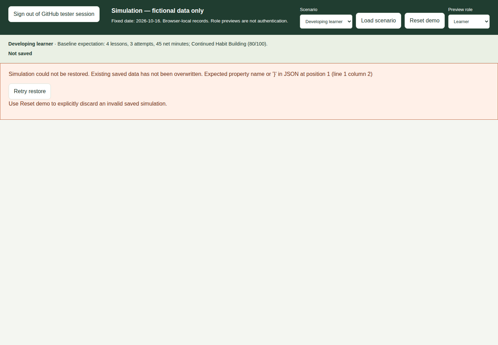

*Figure 17. This screenshot deliberately injected invalid fictional saved data in an isolated browser; normal operation should not show this warning.*

When reporting a problem, record the scenario, preview role, page, numbered reproduction steps, expected result, actual result, device/browser, and save-status message. Use fictional or redacted screenshots only. Do not attach a real-data journal export.

## 17. Suggested acceptance test session

Allow approximately 25–40 minutes. Keep observations outside the app; the checklist is for testers, not a persisted in-app form.

| Test | Steps | Pass condition |
| --- | --- | --- |
| Assessment | Load New learner; personalize the role and outcome. | Recommendations update and assessment persists after refresh. |
| Lesson | Complete one lesson's answer, reflection, and review confirmation. | Row shows Completed after refresh. |
| Evidence | Add three same-task attempts using different applications. | Entries, repeat badge, surface count, and time difference match inputs. |
| Slower attempt | Load Slower attempt. | Net time shows -5 minutes. |
| Private story | Save a story, refresh, reopen it. | Text persists; it is absent from champion and sponsor views. |
| Consent separation | Inspect private evidence before sharing. | No active-learner review item exists just because evidence permits consideration. |
| Workflow review | Submit separately redacted text; approve or request changes as Champion. | Learner sees saved status and feedback. |
| Questions | Ask as Learner; answer as Champion. | Learner sees the saved answer. |
| Nomination | Submit fictional details; approve or decline as Administrator. | Learner sees updated status; no email is sent. |
| Live report | Add +10-minute attempt to fresh Normal cohort. | Attempts 42 to 43; net minutes 570 to 580. |
| Suppression | Load Small cohort; open Sponsor. | No aggregate metrics or export button. |
| Persistence and reset | Refresh, then reset the current scenario. | Refresh retains saved edits; confirmed reset restores fixtures. |
| Mobile | Repeat a learner action using a small viewport. | Navigation, dialog scrolling, and save controls are usable. |

Automated tests additionally cover invalid saved records and failed writes. Do not intentionally corrupt a tester's browser storage just to demonstrate the error screenshot.

## 18. Glossary and boundaries

| Term | Meaning in this app |
| --- | --- |
| Persona | Role-based starting point for recommended habits and prompts. |
| Habit | Repeated useful work practice, not a prompt-volume target. |
| Surface | Application such as Teams, Word, Outlook, Excel, PowerPoint, or Copilot Chat. |
| Capability/agent | Optional specialized tool used within a workflow; not another application surface. |
| Evidence | Learner-entered attempt with timing, outcome, review, and reflection. |
| Redacted submission | Separately typed workflow intended for reviewer consideration, with explicit consent. |
| Value story | Private learner reflection; saving it is not a sharing action. |
| Cohort | Fixed fictional learning group used for repeatable reporting. |
| Readiness | Support-routing score based on simulation rules, not employee evaluation. |
| Sponsor | Aggregate-report preview role, not a viewer of individual journals. |

GitHub sign-in and a server-checked username allowlist now control entry, including online documentation and screenshots. They do not implement production employee identity or role-based record authorization. This milestone still lacks connected database persistence, real video publishing, organizational submissions, real appointments, public publication, formal awards administration, and production reporting privacy controls. All records remain inspectable by someone with access to the browser.

## 19. Operator reference and guide maintenance

### Start the app

The current workspace's two CPU cores and approximately 8 GB RAM are enough. No GPU, model service, or database is required. Normal workspace billing and availability still apply.

From the repository root, with Node.js 22 or 24:

First configure private `GITHUB_CLIENT_ID`, `GITHUB_CLIENT_SECRET`, `NEXTAUTH_SECRET` (random, at least 32 characters), and `NEXTAUTH_URL` (exact application origin), and add approved GitHub usernames to the repository's `tester-allowlist.txt`. Register the matching GitHub OAuth callback at `<origin>/api/auth/callback/github`. The repository's `docs/TESTER-ACCESS.md` has the full setup and verification checklist. Never put secrets in the allowlist or documentation. Without OAuth settings or a valid nonempty list, the app stays closed.

```sh
npm ci
npm run build
npm run start -- --port 3000
```

If dependencies are already installed, skip `npm ci`. Run build and start sequentially. Stop a foreground server with Ctrl+C. For development use `npm run dev -- --port 3000`; do not run dev and production servers against the same build directory simultaneously.

Forward port 3000 privately in VS Code. Private forwarding limits access to the URL, and can block external testers even when their handles are approved. Keep it private until the operator verifies a real GitHub allowed/denied login and explicitly chooses an internet-reachable test deployment. Role previews remain simulation controls, not authorization.

### Guide files and screenshots

- **HTML page:** [Open the HTML edition](index.html).
- **Markdown source:** `USER-GUIDE.md`, alongside the HTML file.
- **Images:** `images/`, alongside both editions.

When the app is running, the HTML guide is available at `/user-guide/index.html` and the Markdown at `/user-guide/USER-GUIDE.md`. You can also open the HTML file locally without the app; keep the entire `user-guide` folder together so its image links work. The HTML includes print styling for browser **Print / Save as PDF**.

### Refresh this documentation

From the repository root:

Online screenshots/checks need `DOCS_STORAGE_STATE` set to a private Playwright storage-state file from an approved sign-in. Set `DOCS_BASE_URL` if not using `http://127.0.0.1:3000`. The scripts import cookies only into isolated contexts, never another tester's local simulation records. Treat that file as a credential and delete it after use; the repository setup guide explains how to create it.

```sh
# App must already be available on port 3000.
npm run docs:screenshots
npm run docs:build
npm run docs:check
```

For a different running app URL:

```sh
DOCS_BASE_URL=http://127.0.0.1:3001 npm run docs:screenshots
```

Screenshot capture uses a separate Playwright browser context with fictional records; it does not replace the simulation in your normal browser. Install Chromium once if required:

```sh
npx playwright install --with-deps chromium
```

`docs:build` renders this Markdown using a pinned Markdown CLI, then generates the styled HTML, navigation, and screenshot captions. The renderer is fetched through npm on first use; an internet connection or an existing npm cache is required. It does not send the guide to an external rendering service.

`docs:check` verifies both screen sizes, screenshot loading, section links, print styling, no-JavaScript reading, and local-file/offline image paths. Like screenshot capture, it requires the running app and installed Playwright Chromium runtime. If public assets were created after a production server started, restart that server before checking or opening the guide.

Screenshots are documentation examples, not proof of production deployment, authenticated privacy, or accessibility certification.
